# ascii-profile-card

A GitHub profile card with a letter drawn as lit, slowly turning 3D ASCII art, next to your name and a few facts. It's one static SVG: no server, no scheduled job, nothing to go stale.

<p align="center">
  <picture></picture>
</p>

Live on my profile: [github.com/ChadisBrad](https://github.com/ChadisBrad)

Part of [ascii-3d-art](https://github.com/ChadisBrad/ascii-3d-art), which has the full engine, a rose and a diamond ring, and the Claude Code skill this card is built on.

## Why I made it

My old profile ran a stats card off a GitHub Action that was meant to refresh every hour. GitHub ran it every six to twelve hours, so the numbers were always out of date, and the README had turned into a wall of badges. I wanted one card that says who I am, doesn't look like every other profile, and never needs a job to keep it current.

The look comes from JIN2's character art ([@jin_22ee](https://github.com/JIN2-ASCII)): objects built from thousands of letters, lit like a 3D model and outlined with slashes. This is my own implementation of that method, cut down to fit a profile card.

## What it does

- Builds the letter as a solid: a bevelled front face plus side walls, from a single stroke path.
- Lights it with a fixed key light and a rim light that circles, so the edges catch the light as it sways.
- Draws it in characters. `| / \ - _` trace the edges, denser letters fill the brighter areas, and a couple of sparkles sit on the highlights.
- Renders 48 frames and switches between them with CSS inside the SVG, so it animates in a README without JavaScript. If a visitor has reduced motion turned on, they get a still frame.
- Puts your name, a tagline and up to 8 facts beside it, all from one JSON file.

## Use it

1. Click **Use this template** and name the new repo exactly your GitHub username. That's the repo GitHub shows on your profile.
2. Edit `profile.config.json`.
3. Run `node scripts/gen-card.mjs`. It needs Node 18 or later and has no dependencies.
4. Replace `README.md` with the card and anything else you want under it:

   ```html
   <picture></picture>
   ```

   The `<picture>` wrapper stops GitHub turning the card into a link to the raw SVG.
5. Commit `assets/card.svg`.

## Config

| Key | What it is |
| --- | --- |
| `name` | Your name, up to 28 characters. |
| `tagline` | One line under your name, up to 52 characters. |
| `facts` | Up to 8 `[label, value]` rows. Labels up to 9 characters, values up to 52. |
| `shape.spine` | Optional. The stroke path for your letter (see below). Defaults to an S. |
| `shape.thickness` | Optional. Stroke half-width, from 0.12 to 0.35. Defaults to 0.25. |

The generator checks the file and tells you which field is wrong.

## Draw your own letter

The letter is one thick stroke along a path. Points sit in a box from -1 to 1, with x to the right and y up. Corners are rounded for you.

```json
"shape": { "spine": [[-0.55, 1], [-0.55, -1], [0.6, -1]] }
```

That's an L. Letters you can draw in one stroke work best: C, J, L, M, N, S, U, V, W, Z.

## How it works

`scripts/ascii3d.mjs` is the engine: point clouds, lighting, projection and the character grid. `scripts/gen-card.mjs` builds the shape and writes the SVG.

Each frame goes: stroke path → 3D points with surface normals → turn → light → project onto a 44 × 27 grid → nearest point wins each cell → edge characters and fill → SVG text.

Run the tests with `node --test scripts/gen-card.test.mjs`.

## Credits

The method is after JIN2 ([@jin_22ee](https://github.com/JIN2-ASCII)). None of his code is in this repo. The card carries a small credit line; please leave it in.

## Licence

MIT. See [LICENSE](LICENSE).
